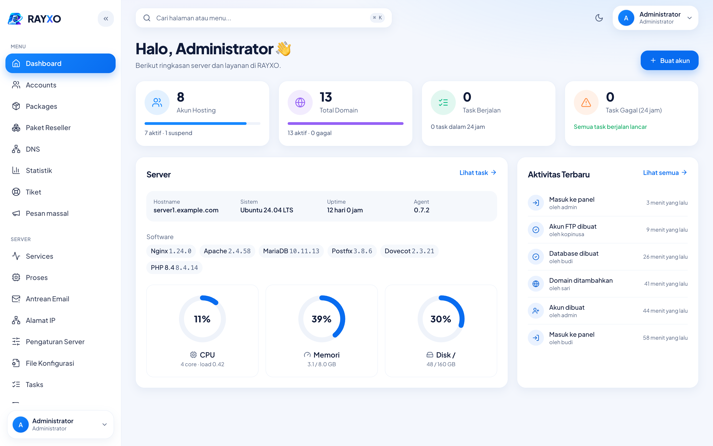
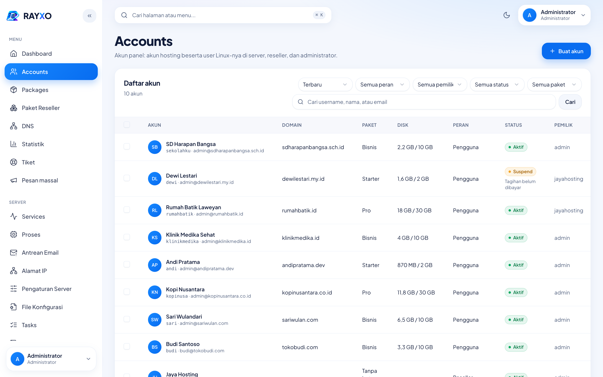
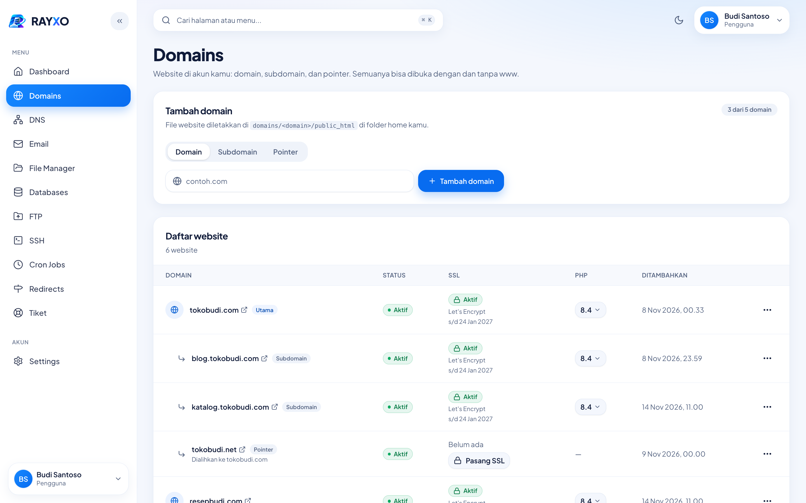
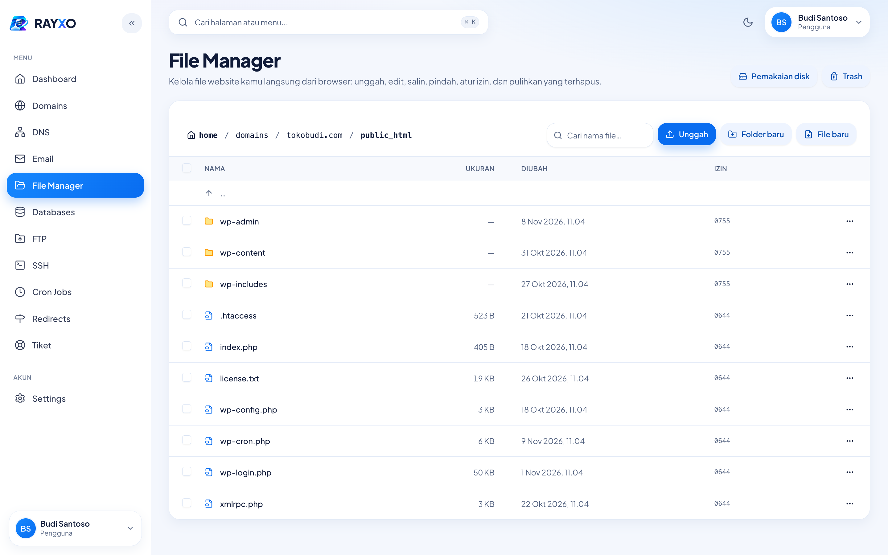
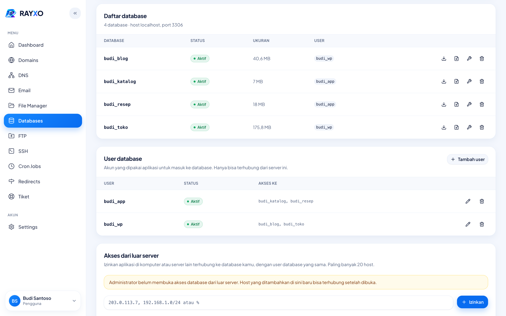
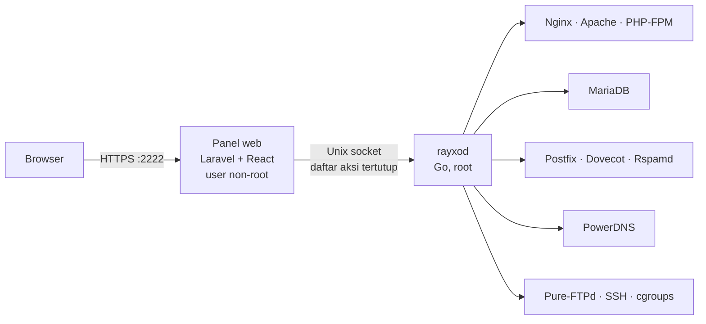

<p align="center">
  
</p>

<p align="center">
  <strong>Panel hosting gratis dan open source untuk VPS Ubuntu.</strong><br>
  Alternatif cPanel dan DirectAdmin: Admin, Reseller, dan User dalam satu panel, terpasang dengan satu perintah.
</p>

<p align="center">
  <a href="https://github.com/fianbiasa/rayxo/releases/latest"></a>
  
  <a href="LICENSE"></a>
</p>

<p align="center">
  <a href="https://rayxopanel.com">Website</a> ·
  <a href="https://rayxopanel.com/docs/">Dokumentasi</a> ·
  <a href="https://rayxopanel.com/docs/installation/">Panduan instalasi</a> ·
  <a href="https://rayxopanel.com/changelog/">Changelog</a> ·
  <a href="https://github.com/fianbiasa/rayxo/discussions">Diskusi</a>
</p>

<p align="center">
  
</p>

> **Status:** beta, versi terbaru [v0.7.2](https://github.com/fianbiasa/rayxo/releases/latest). Backup dan migrasi belum ada, lihat [Berikutnya](#berikutnya).

## Instalasi

Di server Ubuntu 24.04 yang masih bersih, sebagai root:

```bash
wget https://github.com/fianbiasa/rayxo/releases/latest/download/setup.sh
```

```bash
bash setup.sh --admin-email kamu@domainmu.com
```

Di akhir instalasi muncul alamat panel (`https://<hostname>:2222`), username, dan password admin. Password hanya ditampilkan sekali dan tidak masuk log.

Sebelum menjalankan, pastikan hostname server berupa FQDN dengan A record dan PTR yang mengarah ke IP server, dan port yang dibutuhkan sudah terbuka. `setup.sh` mengecek semuanya dan berhenti kalau ada yang belum siap. Detailnya ada di bawah atau di [panduan instalasi](https://rayxopanel.com/docs/installation/).

<details>
<summary><strong>Syarat lengkap dan port</strong></summary>

- Ubuntu 24.04 LTS yang masih bersih, akses root.
- Hostname berupa FQDN, misalnya `server1.domainmu.com`.
- **A record** hostname → IP publik server (kalau memakai Cloudflare: _DNS only_, bukan proxy). Tidak boleh ada AAAA record yang mengarah ke server lain.
- **PTR (reverse DNS)** IP publik → hostname, diatur lewat provider VPS.
- Port terbuka dari internet (firewall / security group provider VPS):

    | Port                             | Untuk                     |
    | -------------------------------- | ------------------------- |
    | 80, 443                          | Website dan Let's Encrypt |
    | 2222                             | Panel                     |
    | 22                               | SFTP dan SSH              |
    | 21, 35000–35999                  | FTP (passive)             |
    | 25, 110, 143, 465, 587, 993, 995 | Email (SMTP, POP3, IMAP)  |
    | 53 TCP dan UDP                   | DNS                       |

Dengan syarat itu terpenuhi, `setup.sh` otomatis memasang **SSL Let's Encrypt** untuk hostname (diperpanjang otomatis oleh `certbot.timer`), sehingga panel bisa dibuka normal di `https://<hostname>:2222`, dan `http://<hostname>` diarahkan ke sana.

</details>

<details>
<summary><strong>Pilihan instalasi, email panel, dan lupa password</strong></summary>

`setup.sh` dari sebuah rilis otomatis mengunduh paket rilis yang sama dari GitHub dan memverifikasi checksum-nya. Versi tertentu: `--version 0.7.2`. Versi PHP untuk website (default 7.4 sampai 8.5): `--php-versions "8.2 8.3 8.4"`; versi yang sudah terpasang tidak dihapus. `setup.sh` aman dijalankan ulang kalau berhenti di tengah. Pilihan lengkap: `bash setup.sh --help`.

**Email panel** (verifikasi, reset password) dikirim lewat Postfix di server itu sendiri (port 587 dengan login `rayxo@<hostname>`) dan ditandatangani DKIM oleh OpenDKIM. Di akhir instalasi, `setup.sh` menampilkan rekaman DNS yang perlu dipasang beserta statusnya (✔/✘), dan menyimpannya di `/etc/rayxo/dns-records.txt`:

| Rekaman | Nama                              | Nilai                                               |
| ------- | --------------------------------- | --------------------------------------------------- |
| SPF     | TXT `<hostname>`                  | `v=spf1 a ~all`                                     |
| DKIM    | TXT `rayxo._domainkey.<hostname>` | `v=DKIM1; k=rsa; p=…` (kunci dibuat saat instalasi) |
| DMARC   | TXT `_dmarc.<hostname>`           | `v=DMARC1; p=none; adkim=r; aspf=r`                 |

Jalankan `setup.sh` lagi kapan saja untuk mengecek ulang statusnya.

**Lupa password admin?** Di server, sebagai root:

```bash
rayxo reset-password admin
```

Password baru ditampilkan sekali, dan semua session lama akun itu dikeluarkan.

</details>

## Kenapa RAYXO

- **Gratis, tanpa biaya lisensi.** Targetnya fitur minimal setara DirectAdmin, dengan kode yang bisa diperiksa siapa saja.
- **Panel web tidak pernah jadi root.** Panel jalan sebagai user biasa; semua perubahan sistem lewat agent `rayxod` dengan daftar aksi tertutup. Bug di panel tidak otomatis jadi akses root.
- **Setiap akun terisolasi.** Satu akun hosting adalah satu user Linux dengan home `0710` dan batas CPU, RAM, dan IO lewat cgroups. Satu situs dibobol tidak menular ke akun lain.
- **Familiar untuk pindahan.** Struktur folder dan port panel (2222) mengikuti DirectAdmin, dan `.htaccess` tetap jalan untuk WordPress.
- **Siap untuk jualan hosting.** Tiga level akses (Admin → Reseller → User), paket dengan overselling, serta branding dan nameserver sendiri per reseller.

## Yang sudah bisa dipakai

- **Web:** domain, subdomain, alias, pointer, redirect; Nginx → Apache → PHP-FPM per akun dengan PHP 7.4–8.5 per domain; pengaturan per website (halaman error, folder berpassword, proteksi hotlink, tipe MIME, CGI, batas bandwidth dan disk); log dan laporan GoAccess.
- **SSL:** Let's Encrypt otomatis termasuk wildcard dan `mail.<domain>`, sertifikat sendiri, CSR, dan self-signed.
- **Database:** MariaDB dengan phpMyAdmin sekali klik, import/export, periksa dan perbaiki tabel, akses dari luar server per IP.
- **Email:** Postfix, Dovecot, Rspamd, dan Roundcube; forwarder, catch-all, autoresponder, filter, filter spam, DKIM/SPF/DMARC otomatis, batas kirim, antrean email, dan konfigurasi otomatis aplikasi email.
- **DNS:** PowerDNS dengan template zone (juga template sendiri per reseller), editor record, dan nameserver sendiri per reseller.
- **File & akses:** file manager, FTP/FTPS, SFTP, SSH dalam jail dengan SSH key, cron job.
- **Reseller:** paket reseller dengan overselling dan batas resource per akun, akun dan paket sendiri, masuk sebagai pelanggan, pindah pemilik, branding (nama, warna, logo), dan domain login panel sendiri.
- **Batas & statistik:** kuota disk dan inode, grafik harian bandwidth, disk, CPU, dan RAM, batas CPU/RAM/proses/IO per akun (cgroups, untuk PHP, cron job, dan SSH), alamat IP sendiri per akun (shared atau dedicated).
- **Operasional:** REST API dengan login key, notifikasi email dan Telegram, tiket bantuan dengan lampiran, pesan massal, monitor layanan dengan watchdog, process monitor, editor file konfigurasi, riwayat login, task, dan audit log.
- **Keamanan akun:** setiap akun hosting adalah user Linux sendiri; login panel dengan 2FA atau passkey.

<details>
<summary><strong>Screenshot lainnya</strong></summary>

<p align="center">
  
  
  
  
</p>

</details>

Panduan pemakaian lengkap ada di [rayxopanel.com/docs](https://rayxopanel.com/docs/).

## Cara kerja



Repo ini berisi kode sumber lengkap. Server tidak membangun apa pun: `setup.sh` mengunduh paket rilis yang sudah jadi (panel, agent, phpMyAdmin, Roundcube) dan memverifikasi checksum-nya, jadi server tidak butuh Composer, Node.js, atau Go.

| Bagian     | Pilihan                                                     | Alasan                                                                  |
| ---------- | ----------------------------------------------------------- | ----------------------------------------------------------------------- |
| OS         | Ubuntu 24.04 LTS dulu, Debian menyusul                      | Paling umum di provider VPS; satu OS mengurangi beban perawatan         |
| Panel web  | Laravel + Inertia + React (TypeScript, Tailwind, shadcn/ui) | Interaktif untuk file manager, editor, dan progres task                 |
| Login      | Laravel Fortify                                             | Username/email, 2FA, passkey; pendaftaran publik dimatikan              |
| Agent      | Go, satu binary, jalan sebagai root                         | Eksekusi tanpa shell, mudah dipasang                                    |
| Web server | Nginx → Apache → PHP-FPM per user                           | Cepat, dan `.htaccess` tetap jalan untuk WordPress & pelanggan pindahan |
| DNS        | PowerDNS                                                    | Ada API, siap DNSSEC & cluster                                          |
| Email      | Postfix + Dovecot + Rspamd + Roundcube                      | Standar industri                                                        |
| FTP        | Pure-FTPd (auth MySQL)                                      | Akun FTP virtual per domain                                             |

## Berikutnya

| Fase | Isi                                                                                                                |
| ---- | ------------------------------------------------------------------------------------------------------------------ |
| P4   | Backup dan restore (lokal, FTP, SFTP, S3), impor backup cPanel dan DirectAdmin, transfer antar server, modul WHMCS |
| P5   | Brute force monitor, firewall, ModSecurity, kebijakan 2FA dan password, update panel sekali klik, UI dua bahasa    |
| P6   | App installer dan WordPress manager, Git deploy, Node.js/Python, DNSSEC, multi-server                              |

Panel dirancang untuk menjual shared hosting (Admin → Reseller → User) di satu server; desain agent sudah disiapkan untuk multi-server.

## Bantuan

Pertanyaan dan ide di [Diskusi](https://github.com/fianbiasa/rayxo/discussions), laporan bug di [Issues](https://github.com/fianbiasa/rayxo/issues).

## Untuk pengembang

### Menjalankan secara lokal (Herd)

Panel dilayani Herd di `http://rayxo.test`. Di Mac, agent server disimulasikan (`AGENT_DRIVER=fake`) karena agent asli hanya jalan di Linux.

```bash
composer install && pnpm install
cp .env.example .env && php artisan key:generate
php artisan migrate --seed      # akun demo admin, reseller, dan user (lihat database/seeders/DatabaseSeeder.php)
pnpm run build                  # atau `composer run dev` untuk mode pengembangan
```

- **SSL & versi PHP:** atur dari aplikasi Herd (Sites → `rayxo`). Setelah mengaktifkan HTTPS, ubah `APP_URL` di `.env` menjadi `https://rayxo.test`.
- **Test & pengecekan:** `php artisan test`, `vendor/bin/pint`, `vendor/bin/phpstan analyse`, `pnpm run check`, `pnpm run types:check`.

### Agent server (`agent/`, Go)

```bash
cd agent
make check     # go vet (Mac + Linux), test dengan race detector, gofmt
make build     # bin/rayxod dan bin/rayxo untuk Mac
make linux     # binary statis untuk server: bin/linux-amd64/ dan bin/linux-arm64/
```

**Uji panel dengan agent asli di Mac.** rayxod bisa jalan di macOS khusus untuk pengembangan, karena PHP-FPM Herd jalan sebagai user kamu:

```bash
agent/bin/rayxod --socket "$PWD/storage/app/rayxod.sock" --allow-user "$(whoami)" --socket-group ""
```

Lalu di `.env` set `AGENT_DRIVER=socket` dan `AGENT_SOCKET` ke path socket di atas. Kembalikan ke `AGENT_DRIVER=fake` setelah selesai. Cek cepat tanpa panel: `agent/bin/rayxo -socket storage/app/rayxod.sock ping`.

### Membuat rilis

Rilis dibuat otomatis oleh GitHub Actions (`.github/workflows/release.yml`) setiap kali tag versi di-push:

```bash
git tag v0.8.0 && git push origin v0.8.0
```

Workflow menjalankan `installer/build-release.sh`, lalu menerbitkan `setup.sh`, `rayxo-<versi>-linux-{amd64,arm64}.tar.gz`, dan file `.sha256`-nya di [Releases](https://github.com/fianbiasa/rayxo/releases).

Untuk uji tanpa rilis: jalankan `installer/build-release.sh 0.8.0-dev` di Mac, salin isi `dist/` ke server, lalu `bash setup.sh --package rayxo-0.8.0-dev-linux-amd64.tar.gz`.

## Lisensi

Copyright (C) 2026 Zulfianto

RAYXO adalah perangkat lunak bebas di bawah [GNU Affero General Public License versi 3](LICENSE) (AGPL-3.0). Kamu boleh memakai, menyebarkan, dan mengubahnya. Kalau kamu memodifikasi RAYXO lalu menyediakannya untuk orang lain lewat jaringan, misalnya sebagai panel untuk pelanggan hosting, kode sumber versi modifikasimu juga wajib tersedia untuk mereka.
